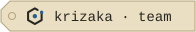

<picture>
  <source media="(prefers-color-scheme: dark)" srcset="assets/header-dark.svg">
  <source media="(prefers-color-scheme: light)" srcset="assets/header-light.svg">
  
</picture>

<a href="https://www.krizaka.com"><picture>
  <source media="(prefers-color-scheme: dark)" srcset="assets/team-dark.svg">
  
</picture></a>

I'm Oussama, and I founded [Krizaka](https://www.krizaka.com) in Montréal.

### § 1 · what Krizaka builds

| | |
| :-- | :-- |
| <picture><source media="(prefers-color-scheme: dark)" srcset="https://krizaka-assets.b-cdn.net/brand/yomizaka/mark-dark.svg"></picture> | **[Yomizaka](https://dev.yomizaka.com)** · leases, contracts and invoices, read and checked; every finding quotes its passage. |
| <picture><source media="(prefers-color-scheme: dark)" srcset="https://krizaka-assets.b-cdn.net/brand/akinaza/mark-dark.svg"></picture> | **[Akinaza](https://dev.akinaza.com)** · the all-in-one for independent Québec shops: hair salons, bakeries, cafés, boutiques. |
| <picture><source media="(prefers-color-scheme: dark)" srcset="https://krizaka-assets.b-cdn.net/brand/orazaka/mark-dark.svg"></picture> | **[Orazaka](https://dev.orazaka.com)** · sovereign AI that runs on your own infrastructure: your data never leaves home. |

### § 2 · open source

- **[Krizaka UI](https://ui.krizaka.com)** · the design system every Krizaka app is made of, documented component by component.
- **[Krizaka Java](https://java.krizaka.com)** · the building blocks of our Java services, on Maven Central.
- **[@krizaka on npm](https://www.npmjs.com/org/krizaka)** · the packages: tokens, fonts, icons, UI, i18n.

### § 3 · the blog

Notes from the workshop, in French first: **[blog.krizaka.com](https://blog.krizaka.com)**.

### § 4 · now

<!-- Edit this list when the focus moves: three lines at most. -->
- Yomizaka: getting the first verification flows into real hands.
- Akinaza: the shop pages for Québec independents.
- Orazaka: the engine both of them run on.

<picture>
  <source media="(prefers-color-scheme: dark)" srcset="assets/stats-dark.svg">
  
</picture>

Drawn by hand in SVG on Krizaka's notebook paper · the log above is redrawn daily by this repository's own Action.
