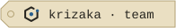
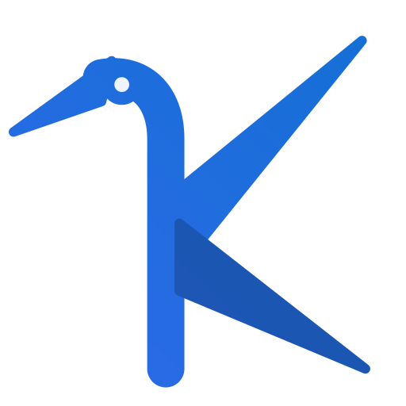

<picture>
  <source media="(prefers-color-scheme: dark)" srcset="assets/header-dark.svg">
  <source media="(prefers-color-scheme: light)" srcset="assets/header-light.svg">
  
</picture>

<a href="https://www.krizaka.com"><picture>
  <source media="(prefers-color-scheme: dark)" srcset="assets/team-dark.svg">
  
</picture></a>

I'm Oussama, and I founded [Krizaka](https://www.krizaka.com) in Montréal.

### § 1 · what Krizaka builds

| | |
| :-- | :-- |
| <picture><source media="(prefers-color-scheme: dark)" srcset="https://krizaka-assets.b-cdn.net/brand/verikora/mark-dark.svg"></picture> | **[Verikora](https://www.verikora.com)** · checks a rental file and a lease, line by line; every finding quotes its passage. In development. |
| <picture><source media="(prefers-color-scheme: dark)" srcset="https://krizaka-assets.b-cdn.net/brand/sovkora/mark-dark.svg"></picture> | **[Sovkora](https://www.sovkora.com)** · the engine and its analysis modules, designed to run on your own premises. In development. |
| <picture><source media="(prefers-color-scheme: dark)" srcset="assets/kridoc-dark.svg"></picture> | **[Kridoc](https://www.kridoc.com)** · a company's documents, filed and findable, encrypted, in Canada. In development. |
| <picture><source media="(prefers-color-scheme: dark)" srcset="https://krizaka-assets.b-cdn.net/brand/folioviv/mark-dark.svg"></picture> | **[Folioviv](https://www.folioviv.com)** · runs an independent shop: bookings, invoices and its own page. In development. |

### § 2 · open source

- **[Krizaka UI](https://ui.krizaka.com)** · the React components, design variables and page blocks every Krizaka product is made of.
- **[Krizaka TypeScript](https://ts.krizaka.com)** · building blocks for server and client, on npm under [@krizaka](https://www.npmjs.com/org/krizaka).
- **[Krizaka Java](https://java.krizaka.com)** · the Spring Boot building blocks of our services; the source and the releases are on GitHub.
- **[Krizaka Rust](https://github.com/krizaka/krizaka-rust)** · the Rust building blocks of our desktop apps.
- **[Krizaka Lab](https://lab.krizaka.com)** · the motion lab: 3D and animation tried out before they reach the products.

### § 3 · the blog

Notes from the workshop, in French first: **[blog.krizaka.com](https://blog.krizaka.com)**.

### § 4 · now

<!-- Edit this list when the focus moves: three lines at most. -->
- Verikora: getting the first verification flows into real hands.
- Sovkora: the engine Verikora runs on, on its way to production.
- Kridoc: business document storage in Canada, from design to code.

<picture>
  <source media="(prefers-color-scheme: dark)" srcset="assets/stats-dark.svg">
  
</picture>

Drawn by hand in SVG on Krizaka's notebook paper · the log above is redrawn daily by this repository's own Action.
